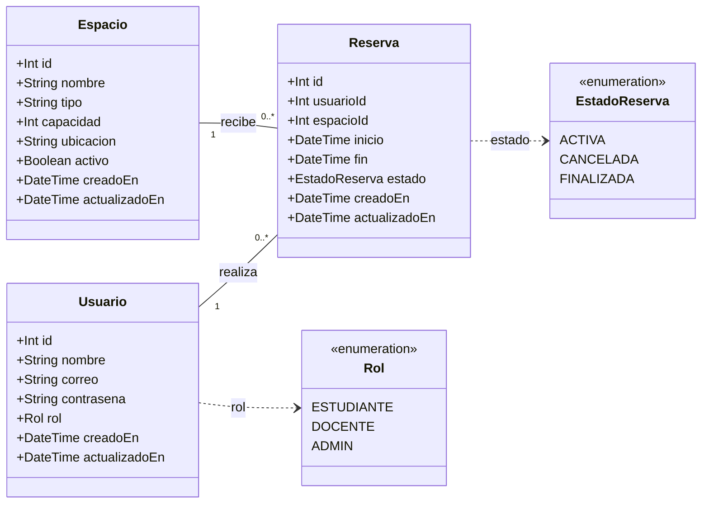

# Componentes, métodos y diagrama de clases

Esta página documenta los modelos Usuario, Espacio y Reserva y las operaciones integradas en [develop](https://github.com/Andy-752109/sistema-reservas-api/tree/develop), revisadas el 12 de noviembre de 2026. Incluye los ajustes de diagnóstico del PR #82 y la conservación del historial del [PR #96](https://github.com/Andy-752109/sistema-reservas-api/pull/96) (issue #88). El estado de una versión desplegada se verifica por separado en [Inicio](Home.md).

## Diagrama de clases



Cada reserva pertenece exactamente a un usuario y a un espacio. Un usuario o espacio puede tener cero o más reservas, incluso de diferentes estados. La multiplicidad no sustituye la validación temporal: solo las reservas ACTIVAS bloquean nuevos intervalos.

El diagrama representa los datos persistidos de Prisma; sus operaciones se implementan en los servicios de la siguiente sección. `contrasena` contiene un **hash bcrypt**, nunca una contraseña en texto plano, y no se devuelve en las respuestas de usuarios. El signo `+` del diagrama identifica atributos del modelo y no implica exposición por HTTP.

## Atributos y restricciones

| Componente | Restricciones y valores iniciales |
|------------|----------------------------------|
| Usuario | `id` entero autoincremental; `correo` único; `rol=ESTUDIANTE` al registrar; fechas de creación y actualización gestionadas por Prisma |
| Espacio | `id` entero autoincremental; `nombre` único; `tipo` es texto, no un enum; `capacidad` entera positiva validada por la API; `activo=true` por defecto |
| Reserva | `id` entero autoincremental; claves foráneas `usuarioId` y `espacioId`; fechas de inicio/fin; `estado=ACTIVA` al crear; índices por espacio/inicio/fin y por usuario |
| Rol | Valores permitidos: ESTUDIANTE, DOCENTE y ADMIN |
| EstadoReserva | ACTIVA, CANCELADA y FINALIZADA. No existe un endpoint de confirmación ni una transición automática a FINALIZADA en la implementación revisada |

Las relaciones de Reserva con Usuario y Espacio usan `onDelete: Restrict`. `DELETE /usuarios/:id` devuelve 409 si existe cualquier reserva del usuario (ACTIVA, CANCELADA o FINALIZADA), conservando usuario e historial sin cambios; solo elimina usuarios sin reservas con 204. La clave foránea protege también las eliminaciones directas y las operaciones concurrentes. Un espacio con reservas se conserva y se desactiva desde el servicio.

## Métodos por componente

Las firmas se resumen para facilitar la lectura; los métodos asíncronos devuelven promesas. `actor` contiene el identificador y el rol vigente del usuario autenticado.

| Servicio / componente | Método implementado | Responsabilidad y resultado |
|-----------------------|---------------------|------------------------------|
| UsuariosService / Usuario | `crear(dto)` | Registra siempre ESTUDIANTE; genera hash bcrypt con costo 12; devuelve el perfil público |
| UsuariosService / Usuario | `listar()` | Lista perfiles públicos por id; el controlador exige ADMIN |
| UsuariosService / Usuario | `consultar(id, actor)` | Devuelve un perfil si el actor es propietario o ADMIN |
| UsuariosService / Usuario | `actualizar(id, dto, actor)` | Modifica campos opcionales del perfil; solo ADMIN puede cambiar `rol`; vuelve a generar el hash si cambia la contraseña |
| UsuariosService / Usuario | `eliminar(id)` | ADMIN: elimina únicamente sin reservas (204); con cualquier reserva devuelve 409 y conserva usuario e historial |
| AuthService / autenticación | `login(dto)` | Valida correo y contraseña con bcrypt; emite `{ access_token }`; credenciales incorrectas reciben 401 |
| EspaciosService / Espacio | `listar(tipo?)` | Lista espacios activos; filtro opcional por tipo |
| EspaciosService / Espacio | `consultar(id)` | Devuelve un espacio activo; un inactivo o inexistente recibe 404 |
| EspaciosService / Espacio | `crear(dto)` | Crea un espacio; nombre repetido recibe 409; el controlador exige ADMIN |
| EspaciosService / Espacio | `actualizar(id, dto)` | Actualiza datos completos y puede reactivar con `activo=true`; el controlador exige ADMIN |
| EspaciosService / Espacio | `eliminar(id)` | Sin reservas, elimina; con cualquier reserva, desactiva; devuelve `{ id, accion }` |
| EspaciosService / Espacio | `verDisponibilidad(id, fecha)` | Devuelve horario y bloques libres máximos de una fecha, descontando solo reservas ACTIVAS |
| ReservasService / Reserva | `listar(actor)` | Lista reservas propias de cualquier estado; ADMIN ve todas; ordena por inicio e id |
| ReservasService / Reserva | `crear(dto, actor)` | Valida fechas, bloquea el espacio activo, comprueba traslape y crea ACTIVA para el actor |
| ReservasService / Reserva | `actualizar(id, dto, actor)` | Solo propietario o ADMIN y reserva ACTIVA; permite cambiar espacio/intervalo, conserva propietario y estado |
| ReservasService / Reserva | `cancelar(id, actor)` | Solo propietario o ADMIN; cambia a CANCELADA sin borrar; repetir conserva el estado |
| ReservasService / Reserva | `validarTraslape(tx, espacioId, inicio, fin, excluirId?, actorId?)` | Método interno al flujo transaccional, sin endpoint propio; rechaza conflicto con 409 y puede excluir la reserva que se modifica |

## Reglas de negocio

### Traslape y concurrencia

Los intervalos son `[inicio, fin)`. Hay conflicto con una reserva ACTIVA del mismo espacio si se cumplen ambas condiciones:

```text
existente.inicio < nuevoFin
existente.fin > nuevoInicio
```

Las reservas contiguas están permitidas: 10:00–11:00 y 11:00–12:00 no se traslapan. Una reserva CANCELADA o FINALIZADA no bloquea disponibilidad. Al actualizar se excluye el id de la propia reserva.

La comprobación y escritura ocurren dentro de una transacción READ COMMITTED. El servicio toma un bloqueo PostgreSQL `FOR NO KEY UPDATE` sobre el espacio para serializar operaciones concurrentes del mismo espacio; al modificar o cancelar, bloquea además la reserva. La consulta de disponibilidad por sí sola no garantiza una reserva: la creación vuelve a validar bajo bloqueo y puede devolver 409.

### Fechas y disponibilidad

La creación/modificación exige fechas ISO 8601 con `Z` u offset explícito e inicio anterior a fin. La disponibilidad usa `fecha=YYYY-MM-DD`, una fecha real y el horario configurado: por defecto 07:00–21:00 en `America/Mexico_City`. Devuelve bloques libres con offset, sin identificar a otros usuarios ni sus reservas. Rechaza horarios inexistentes o ambiguos por cambios de zona horaria.

El horario de consulta de disponibilidad no es una restricción adicional en `ReservasService.crear`: la implementación revisada valida intervalo, estado del espacio y traslape, pero no impone que toda reserva quede dentro de 07:00–21:00 ni que sea futura.

### Cancelación y estados

`DELETE /reservas/:id` es una cancelación lógica: mantiene el registro y cambia `estado` a CANCELADA. No elimina la fila. Puede repetirse; la traza informativa de cancelación solo se emite cuando hay un cambio de estado. La implementación permite cancelar también una FINALIZADA; no hay una validación de ACTIVA en ese método. En cambio, solo una ACTIVA puede modificarse mediante PUT.

### Permisos

El autorregistro siempre crea ESTUDIANTE, aunque el cliente intente enviar otro rol. El rol se obtiene de PostgreSQL al validar el JWT, por lo que no basta modificar el payload o conservar un token con un rol anterior. Un token de un usuario eliminado deja de autorizar solicitudes. Si la eliminación se rechaza con 409 por tener reservas, el usuario permanece y conserva su acceso.

ESTUDIANTE y DOCENTE operan sobre sus propias reservas y su propio perfil. ADMIN puede operar sobre perfiles y reservas ajenas y administrar espacios. Las rutas públicas de catálogo y disponibilidad no requieren JWT. Los perfiles de respuesta nunca incluyen contraseña ni hash.

## Endpoints

Las rutas no llevan un prefijo `/api`: ese prefijo solo aparece en las rutas de documentación de Swagger. Para rutas autenticadas se utiliza `Authorization: Bearer <JWT>`.

### Usuarios y autenticación

| Método | Ruta | Acceso requerido | Respuesta de éxito | Errores previstos |
|--------|------|------------------|--------------------|-------------------|
| POST | `/usuarios` | Público; registro como ESTUDIANTE | 201, perfil sin hash | 400 datos inválidos; 409 correo duplicado |
| POST | `/login` | Público | 200, `{ access_token }` | 400 datos inválidos; 401 credenciales incorrectas |
| GET | `/usuarios` | ADMIN | 200, lista de perfiles sin hashes | 401, 403 |
| GET | `/usuarios/:id` | Propietario o ADMIN | 200, perfil sin hash | 400, 401, 403, 404 |
| PATCH | `/usuarios/:id` | Propietario o ADMIN; cambiar rol exige ADMIN | 200, perfil actualizado sin hash | 400, 401, 403, 404, 409 |
| DELETE | `/usuarios/:id` | ADMIN | 204 sin reservas, sin cuerpo | 400, 401, 403, 404; 409 si tiene reservas de cualquier estado |

### Espacios

| Método | Ruta | Acceso requerido | Respuesta de éxito | Errores previstos |
|--------|------|------------------|--------------------|-------------------|
| GET | `/espacios?tipo=CUBICULO` | Público; `tipo` opcional | 200, lista de espacios activos | 400 |
| GET | `/espacios/:id` | Público | 200, espacio activo | 400, 404 |
| GET | `/espacios/:id/disponibilidad?fecha=2026-11-20` | Público; `fecha` obligatoria | 200, `{ espacioId, fecha, zonaHoraria, horario, bloquesLibres }` | 400 fecha/id inválidos; 404 espacio no activo o inexistente |
| POST | `/espacios` | ADMIN | 201, espacio creado | 400, 401, 403, 409 |
| PUT | `/espacios/:id` | ADMIN | 200, espacio actualizado | 400, 401, 403, 404, 409 |
| DELETE | `/espacios/:id` | ADMIN | 200, `{ id, accion: "eliminado" }` o `{ id, accion: "desactivado" }` | 400, 401, 403, 404 |

### Reservas

| Método | Ruta | Acceso requerido | Respuesta de éxito | Errores previstos |
|--------|------|------------------|--------------------|-------------------|
| GET | `/reservas` | JWT; propias para ESTUDIANTE/DOCENTE, todas para ADMIN | 200, lista de reservas | 401 |
| POST | `/reservas` | JWT; propietario tomado del token | 201, reserva ACTIVA | 400 intervalo/espacio inválido; 401; 404 espacio inexistente; 409 traslape |
| PUT | `/reservas/:id` | Propietario o ADMIN | 200, reserva actualizada | 400, 401, 403, 404, 409 traslape o estado distinto de ACTIVA |
| DELETE | `/reservas/:id` | Propietario o ADMIN | 200, reserva CANCELADA conservada | 400, 401, 403, 404 |

POST/PUT de reservas reciben `{ espacioId, inicio, fin }`, sin `usuarioId` ni `estado`. No existe un GET individual de reserva ni un endpoint para confirmar/finalizar reservas. PUT de espacios requiere nombre, tipo, capacidad y ubicación completos; `activo` es opcional. PATCH de usuario admite campos opcionales, pero rechaza valores `null`.

### Sistema y documentación

| Método | Ruta | Acceso requerido | Respuesta |
|--------|------|------------------|-----------|
| GET | `/` | Público | 200, texto `Hello World!` |
| GET | `/health` | Público | 200, `{ status: "ok", version, database: "up" }`; 503 con `status: "error"` y `database: "down"` si falla la consulta |
| GET | `/api/docs` | Público | 200, interfaz HTML de Swagger |
| GET | `/api/docs-json` | Público | 200, documento OpenAPI JSON |
| GET | `/api/docs-yaml` | Público | 200, documento OpenAPI YAML |

En general, 400 indica entrada inválida, 401 ausencia o invalidez de autenticación, 403 falta de permiso, 404 recurso no disponible y 409 conflicto de negocio. Para errores 5xx, el filtro global conserva el diagnóstico original y su stack en los logs privados del servidor, exporta a telemetría el tipo y, cuando aplica, el código de Prisma, y evita revelar detalles internos en la respuesta HTTP. CORS puede rechazar un origen de navegador no permitido con 403, antes de ejecutar la operación. La API no requiere cookies cross-origin.

## Fuentes y navegación

- [Esquema Prisma](https://github.com/Andy-752109/sistema-reservas-api/blob/develop/prisma/schema.prisma).
- [Usuarios y autenticación](https://github.com/Andy-752109/sistema-reservas-api/tree/develop/src/usuarios), [AuthService](https://github.com/Andy-752109/sistema-reservas-api/blob/develop/src/auth/auth.service.ts) y [JwtStrategy](https://github.com/Andy-752109/sistema-reservas-api/blob/develop/src/auth/jwt.strategy.ts).
- [Espacios](https://github.com/Andy-752109/sistema-reservas-api/tree/develop/src/espacios) y [reservas](https://github.com/Andy-752109/sistema-reservas-api/tree/develop/src/reservas).
- [Swagger y esquemas de respuesta](https://github.com/Andy-752109/sistema-reservas-api/blob/develop/src/common/dto/api-responses.dto.ts).
- [Issue #15](https://github.com/Andy-752109/sistema-reservas-api/issues/15), [Inicio](Home.md) y [Descripción](Descripcion.md). El estado de publicación se documenta en [README](README.md); fusionar estos archivos no publica la pestaña Wiki automáticamente.
