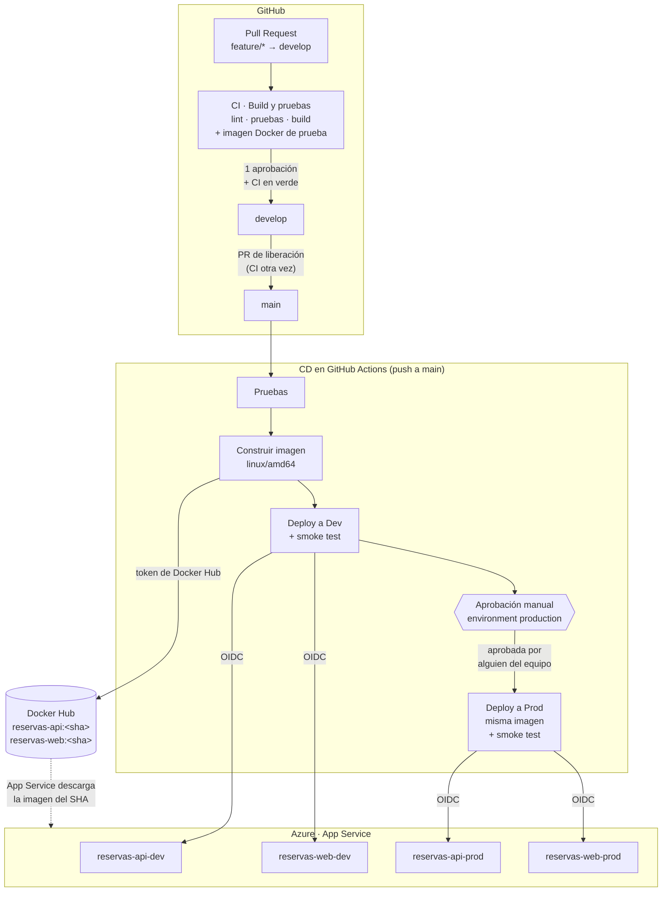

# Deployment y flujo CI/CD

Cada cambio llega a producción por el mismo camino: **PR → CI → merge a `main` → imagen en Docker Hub → Dev → aprobación → Prod**. La API y el web tienen cada uno su pipeline en GitHub Actions, y los dos siguen este patrón.

## Diagrama de deployment

El mismo diagrama aplica a los dos repositorios: el de la API despliega `reservas-api-dev` y `reservas-api-prod`; el del web, `reservas-web-dev` y `reservas-web-prod`.

## Los dos pipelines

### CI: en cada Pull Request

| Repositorio | Workflow | Qué hace | Check obligatorio |
|-------------|----------|----------|-------------------|
| API | `ci.yml` | `npm ci` → lint → pruebas unitarias con cobertura mínima del 70 % → pruebas e2e contra PostgreSQL → build | **Build y pruebas** |
| API | `docker.yml` | Construye la imagen para `linux/amd64` sin publicarla, para detectar un Dockerfile roto antes del merge | Imagen Docker |
| Web | `ci.yml` | `npm ci` → lint → pruebas con Vitest (reporte JUnit) → build | **Build y pruebas** |
| Web | `docker.yml` | Construye la imagen de nginx sin publicarla | Imagen Docker |

Ningún PR se fusiona con el CI en rojo: los checks son obligatorios en la protección de `develop` y `main`, además de 1 aprobación.

### CD: en cada push a `main`

| Paso | API (`cd.yml` + `deploy.yml`) | Web (#53) |
|------|-------------------------------|-----------|
| 1. Pruebas | Reutiliza `ci.yml` | Reutiliza `ci.yml` |
| 2. Imagen | `docker.yml` publica `reservas-api:<sha>` y `latest` | `docker.yml` publica `reservas-web:<sha>` y `latest` |
| 3. Dev | Despliega `<sha>` en `reservas-api-dev`. Al arrancar, el contenedor aplica las migraciones (`prisma migrate deploy`) | Despliega `<sha>` en `reservas-web-dev`. Al arrancar, el contenedor genera `config.js` con la URL de la API de Dev |
| 4. Aprobación | El job de Prod espera en el environment `production` | Igual |
| 5. Prod | Despliega **la misma imagen** que se probó en Dev | Igual |

El CD del web se completa con el issue #53, siguiendo el mismo patrón que la API.

**Por qué se despliega el SHA y no `latest`:** el SHA identifica exactamente qué commit corre en cada ambiente. Prod recibe la imagen que ya pasó por Dev, no una que se haya publicado después.

**Una liberación a la vez:** el CD usa `concurrency` con `cancel-in-progress: false`; si se fusionan dos liberaciones seguidas, la segunda espera y ningún despliegue se corta a medias.

## Gate de aprobación

| Environment de GitHub | Protección | Recibe |
|-----------------------|------------|--------|
| `development` | Ninguna: se despliega en cuanto termina la imagen | Dev |
| `production` | **Aprobación manual** de cualquier integrante del equipo y solo desde `main` | Prod |

Cuando el CD llega a Prod, GitHub pausa el job y muestra **Review deployments** en el run. Quien aprueba debe revisar antes que Dev funcione: la página carga, el footer dice `DEV` con la versión nueva y el login responde.

## Smoke test después de cada despliegue

El job no termina con "desplegado"; comprueba que el ambiente realmente funcione:

1. **Versión correcta:** espera hasta 10 minutos a que `/health` responda con el SHA del commit. El SHA se registra en la Web App **después** de cambiar la imagen; si fuera antes, la imagen vieja podría responder con el SHA nuevo y la prueba pasaría por error.
2. **Base de datos:** `/health` debe reportar `"database":"up"`.
3. **Integración con el web:** una petición de prueba con el `Origin` del web de ese ambiente confirma que CORS lo acepta.

Si cualquiera falla, el job queda en rojo y **Prod no se despliega**.

## Secrets y conexiones

En Azure DevOps esto serían las *service connections*. En GitHub Actions son dos credenciales, ninguna es una contraseña:

### OIDC a Azure (sin contraseñas guardadas)

1. En Microsoft Entra ID existe un *service principal* (una identidad para el pipeline) con **credenciales federadas** que confían en los tokens de GitHub de estos repositorios y sus environments.
2. Cuando un job corre, GitHub le entrega un token firmado de corta duración (por eso el workflow pide `permissions: id-token: write`).
3. `azure/login` cambia ese token por un acceso temporal a Azure. No hay ningún secreto de larga duración que pueda filtrarse; si alguien copia el workflow en otro repositorio, Azure no lo acepta.

| Nombre | Tipo | Para qué |
|--------|------|----------|
| `AZURE_CLIENT_ID` | Secret | Identifica al service principal |
| `AZURE_TENANT_ID` | Secret | Directorio de Entra ID |
| `AZURE_SUBSCRIPTION_ID` | Secret | Suscripción donde viven los recursos |

### Token de Docker Hub

| Nombre | Tipo | Para qué |
|--------|------|----------|
| `DOCKERHUB_USERNAME` | Variable | Cuenta de Docker Hub (`andreaarv`) |
| `DOCKERHUB_TOKEN` | Secret | Token de acceso con permiso de escritura. Nunca la contraseña de la cuenta |

Solo el CD inicia sesión en Docker Hub. En los PR la imagen se construye sin publicarse, así que un PR no puede subir imágenes.

### Variables de cada environment

| Variable | Ejemplo | Para qué |
|----------|---------|----------|
| `API_WEBAPP_NAME` | `reservas-api-dev-rw39me` | Web App a desplegar |
| `AZURE_RESOURCE_GROUP` | `reservas-rg` | Grupo de recursos |
| `WEB_URL` | `https://reservas-web-dev-rw39me.azurewebsites.net` | Origen que el smoke test usa para comprobar CORS |

Los secretos de la aplicación (`DATABASE_URL`, `JWT_SECRET`) no pasan por GitHub: Terraform los entrega directamente a cada Web App como *app settings*. Ver [Infraestructura Dev y Prod](https://github.com/Andy-752109/sistema-reservas-api/wiki/Infraestructura).

## Liberación diaria

1. PR de `develop` a `main`; el CI corre otra vez.
2. Al fusionarlo, el CD despliega solo a Dev.
3. Se prueba Dev.
4. Alguien del equipo aprueba en **Review deployments**, y la misma imagen llega a Prod.
5. El footer de Prod muestra la versión nueva.
