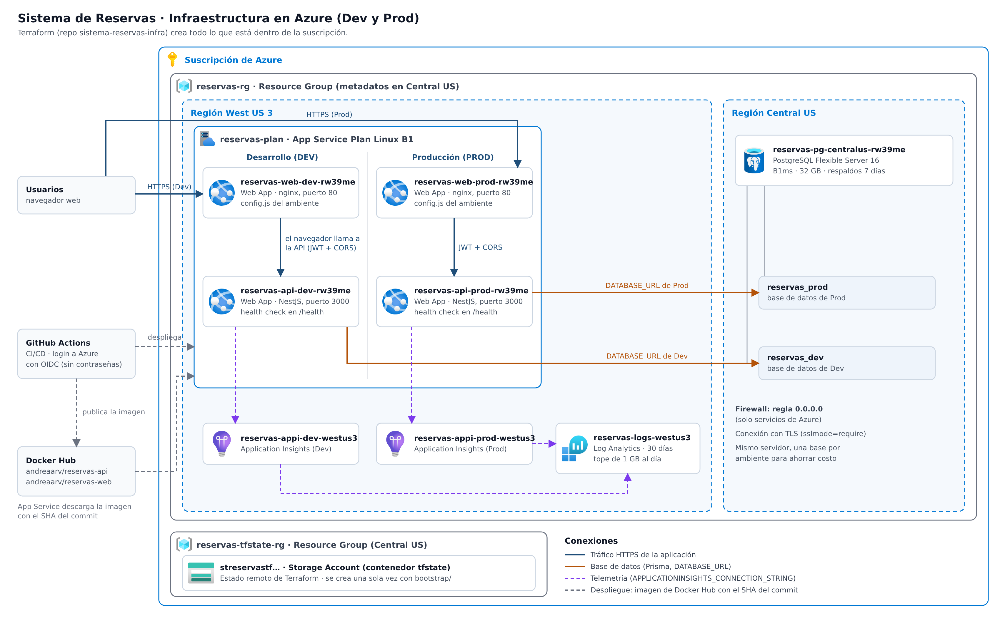
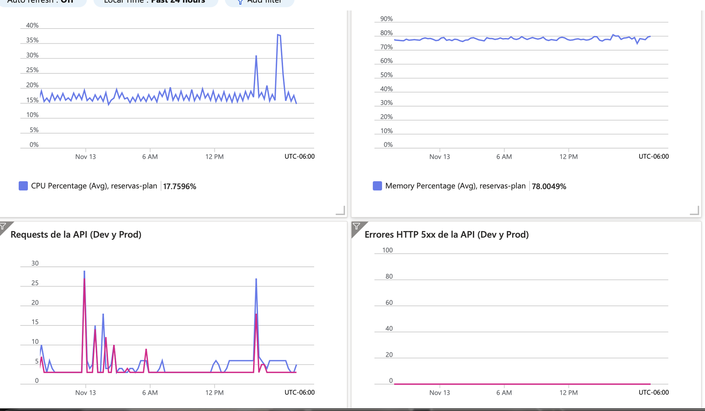
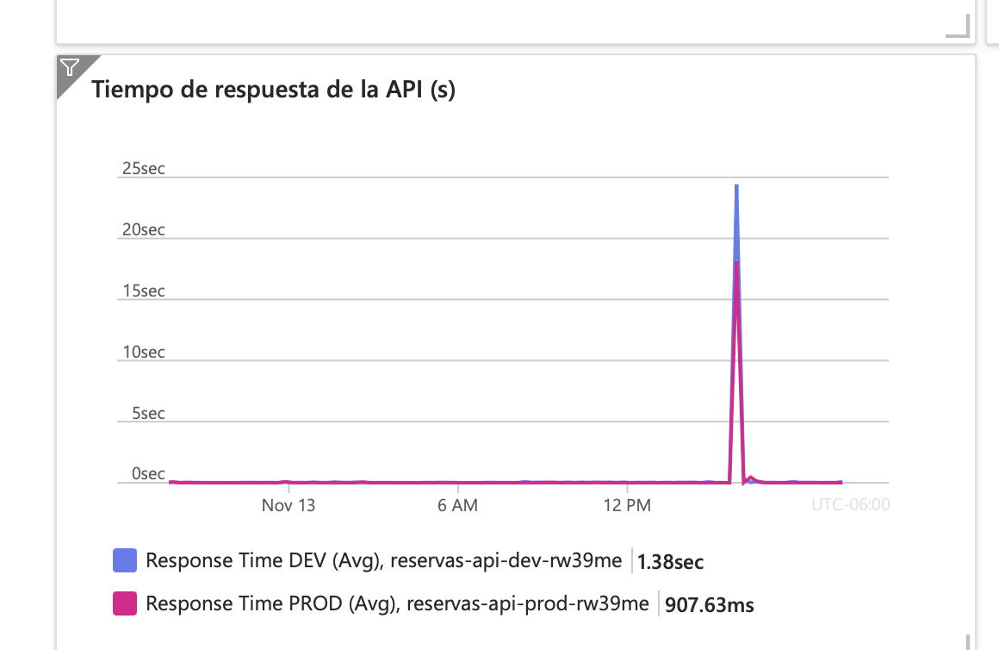

# Infraestructura Dev y Prod

Toda la infraestructura vive en Microsoft Azure y se crea con **Terraform** desde el repositorio [`sistema-reservas-infra`](https://github.com/Andy-752109/sistema-reservas-infra). Nada se crea a mano en el portal: cualquier cambio entra por PR, con `terraform fmt`, `validate` y `plan` revisados.

Los dos ambientes, **Dev** y **Prod**, comparten el mismo App Service Plan y el mismo servidor de PostgreSQL para reducir costos, pero cada uno tiene sus propias Web Apps, su propia base de datos y su propio Application Insights.

## Diagrama

## Recursos

| Recurso | Nombre | SKU / configuración | Región | Propósito |
|---------|--------|---------------------|--------|-----------|
| Resource Group | `reservas-rg` | — | Central US (solo metadatos) | Agrupa todos los recursos del proyecto |
| App Service Plan | `reservas-plan` | Linux **B1** (1 vCPU, 1.75 GB) | West US 3 | Cómputo compartido por las 4 Web Apps; de aquí salen las métricas de CPU y memoria |
| Web App | `reservas-web-dev-rw39me` | Contenedor `reservas-web` (nginx, puerto 80) | West US 3 | Frontend de Dev |
| Web App | `reservas-web-prod-rw39me` | Contenedor `reservas-web` (nginx, puerto 80) | West US 3 | Frontend de Prod |
| Web App | `reservas-api-dev-rw39me` | Contenedor `reservas-api` (NestJS, puerto 3000), health check en `/health` | West US 3 | API de Dev |
| Web App | `reservas-api-prod-rw39me` | Contenedor `reservas-api` (NestJS, puerto 3000), health check en `/health` | West US 3 | API de Prod |
| PostgreSQL Flexible Server | `reservas-pg-centralus-rw39me` | **B1ms**, PostgreSQL 16, 32 GB, respaldos de 7 días | Central US | Servidor de base de datos de ambos ambientes |
| Base de datos | `reservas_dev` | — | Central US | Datos de Dev |
| Base de datos | `reservas_prod` | — | Central US | Datos de Prod |
| Regla de firewall | `permitir-servicios-azure` | `0.0.0.0` | Central US | Permite que las Web Apps se conecten a PostgreSQL |
| Log Analytics | `reservas-logs-westus3` | 30 días de retención, tope de 1 GB al día | West US 3 | Guarda los logs y la telemetría de ambos ambientes |
| Application Insights | `reservas-appi-dev-westus3` | Basado en el workspace | West US 3 | Monitoreo de la API de Dev |
| Application Insights | `reservas-appi-prod-westus3` | Basado en el workspace | West US 3 | Monitoreo de la API de Prod |
| Dashboard del portal | `reservas-dashboard` | 5 gráficas de Azure Monitor, últimas 24 h | West US 3 | Métricas de CPU, memoria, requests, errores 5xx y tiempo de respuesta ([detalle](#métricas-y-dashboard)) |
| Resource Group | `reservas-tfstate-rg` | — | Central US | Separado del proyecto para que `terraform destroy` no borre el estado |
| Storage Account | `streservastf…` (contenedor `tfstate`) | Standard LRS | Central US | Estado remoto de Terraform; se crea una sola vez con `bootstrap/` |

Fuera de Azure:

| Servicio | Uso |
|----------|-----|
| Docker Hub (`andreaarv/reservas-api`, `andreaarv/reservas-web`) | Registro de imágenes. Cada imagen se etiqueta con el SHA corto del commit y con `latest`; Dev y Prod siempre despliegan la del SHA |
| GitHub Actions | CI/CD. Entra a Azure con OIDC, sin contraseñas guardadas |

## Cómo se conecta todo

1. **Usuario → Web App del web.** El navegador descarga el frontend por HTTPS. Al arrancar, el contenedor genera `config.js` con la URL de la API, el ambiente y la versión, así que la misma imagen sirve en Dev y en Prod.
2. **Navegador → Web App de la API.** El frontend llama a la API de su mismo ambiente con `Authorization: Bearer <JWT>`. La API solo acepta peticiones del web de su ambiente (CORS).
3. **API → PostgreSQL.** Cada API usa su propia `DATABASE_URL` (`reservas_dev` o `reservas_prod`) con TLS obligatorio (`sslmode=require`). Al arrancar, el contenedor aplica las migraciones con `prisma migrate deploy`.
4. **API → Application Insights.** Cada API manda su telemetría al Application Insights de su ambiente; ambos guardan los datos en el mismo Log Analytics.
5. **Docker Hub → Web Apps.** En cada despliegue, App Service descarga la imagen con el SHA del commit.

## Configuración por ambiente

Terraform entrega a cada Web App sus variables como *app settings*. Ningún secreto está escrito en los repositorios.

| Web App | Variables |
|---------|-----------|
| Web (`reservas-web-*`) | `API_URL`, `AMBIENTE` (`DEV` o `PROD`), `APP_VERSION`, `WEBSITES_PORT=80` |
| API (`reservas-api-*`) | `DATABASE_URL`, `JWT_SECRET` (uno por ambiente), `CORS_ORIGINS`, `APPLICATIONINSIGHTS_CONNECTION_STRING`, `COMMIT_SHA`, `AMBIENTE`, `WEBSITES_PORT=3000` |

## Métricas y dashboard

El dashboard compartido **Sistema de Reservas · Métricas** está definido en Terraform ([`dashboard.tf`](https://github.com/Andy-752109/sistema-reservas-infra/blob/develop/dashboard.tf)); `terraform output dashboard` da su enlace en el portal. Usa métricas de Azure Monitor, así que no depende del código de la API.

| Gráfica | Métrica | Recurso |
|---------|---------|---------|
| CPU del App Service Plan | `CpuPercentage` (promedio) | `reservas-plan` |
| Memoria del App Service Plan | `MemoryPercentage` (promedio) | `reservas-plan` |
| Requests de la API | `Requests` (total) | API de Dev y de Prod |
| Errores HTTP 5xx de la API | `Http5xx` (total) | API de Dev y de Prod |
| Tiempo de respuesta de la API | `HttpResponseTime` (promedio) | API de Dev y de Prod |

CPU y memoria se miden en el plan porque las 4 Web Apps lo comparten: es el consumo real de la máquina que se paga.

Lectura del 13 de noviembre de 2026, últimas 24 horas:

| Gráfica | Valor | Interpretación |
|---------|-------|----------------|
| CPU | 15–20 %, picos de 38 % | Holgado; los picos coinciden con los despliegues |
| Memoria | ~78 %, estable | Cuatro contenedores en 1.75 GB. Es el costo de compartir un B1 y lo primero que habría que escalar |
| Requests | 3–30 por intervalo | Sobre todo health checks de App Service y smoke tests del CD |
| Errores 5xx | 0 en Dev y Prod | Sin errores del servidor |
| Tiempo de respuesta | ~0.03 s, un pico de ~25 s | El pico es el arranque en frío del contenedor durante la primera liberación; por eso el smoke test del CD espera hasta 10 minutos |

Las trazas de negocio (`reserva.creada`, `reserva.traslape`…) y los errores de la aplicación no están en este dashboard: se consultan en el Application Insights de cada ambiente.

## Decisiones de costo y de diseño

| Decisión | Por qué | En un proyecto real |
|----------|---------|---------------------|
| Un App Service Plan B1 para las 4 Web Apps | Es el plan más barato con contenedores, Always On y health check; el gratuito (F1) se duerme y tarda en responder en la demo | Prod en su propio plan, aislado de Dev y con autoescalado |
| Un servidor PostgreSQL con dos bases | Aísla Dev y Prod a nivel de base de datos sin pagar dos servidores | Un servidor por ambiente |
| Dev y Prod comparten el usuario administrador de PostgreSQL | Consecuencia de usar un solo servidor | Un usuario por base, con permisos mínimos |
| Regla de firewall `0.0.0.0` | Permite servicios de Azure, pero de **cualquier** suscripción, no solo las nuestras; la contraseña y TLS siguen siendo obligatorios | Red privada (VNet y private endpoint) |
| Recursos en West US 3 | La suscripción no tenía cuota de App Service B1 en Central US | — |
| PostgreSQL en Central US | West US 3 rechazó B1ms por falta de capacidad. Agrega unos 35 ms por consulta, imperceptible para el usuario | Base y API en la misma región |
| Nombres con la región (`-westus3`, `-centralus`) | Azure no deja reutilizar en el mismo grupo un nombre que existió en otra región | — |
| Tope de 1 GB al día en Log Analytics | Un error en bucle no puede consumir el crédito | Tope según el volumen esperado |

El detalle de variables, outputs y cómo aplicar Terraform está en el [README del repo de infraestructura](https://github.com/Andy-752109/sistema-reservas-infra#readme).
