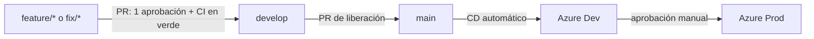

# Stack tecnológico y estrategia de ramas

## Stack tecnológico

El sistema se divide en dos repositorios: la API (`sistema-reservas-api`) y la aplicación web (`sistema-reservas-web`). Cada tecnología se eligió por lo que aporta al proyecto y por su costo bajo o nulo.

### Backend (API)

| Tecnología | Para qué se usa | Por qué la elegimos |
|------------|-----------------|---------------------|
| Node.js + TypeScript | Lenguaje y entorno de ejecución de la API | Un solo lenguaje en frontend y backend; los tipos detectan errores antes de ejecutar. |
| NestJS | Framework de la API REST | Organiza el código en módulos, controladores y servicios, así cada integrante trabaja en su módulo sin pisar a los demás. |
| PostgreSQL | Base de datos | El dominio es relacional (usuarios, espacios y reservas) y Azure lo ofrece como servicio administrado. |
| Prisma | ORM y migraciones | El esquema vive en un solo archivo versionado y las migraciones se aplican igual en local, Dev y Prod. |
| JWT + Passport | Autenticación y control por rol | Sesiones sin estado en el servidor; los Guards de NestJS restringen acciones a estudiante, docente o administrador. |
| Jest | Pruebas unitarias | Viene integrado con NestJS y genera reportes de cobertura para el pipeline. |
| Swagger / OpenAPI | Documentación de endpoints | Se genera desde el código y permite probar la API desde el navegador (`/api/docs`). |

### Frontend (web)

| Tecnología | Para qué se usa | Por qué la elegimos |
|------------|-----------------|---------------------|
| React + TypeScript | Interfaz de usuario | Componentes reutilizables y el mismo lenguaje que la API. |
| Vite | Servidor de desarrollo y build | Arranca en milisegundos y genera archivos estáticos listos para servir. |
| ESLint | Revisión de estilo y errores | Mantiene un código uniforme y lo verifica el pipeline en cada PR. |
| Vitest + Testing Library | Pruebas unitarias del frontend | Usa la misma configuración de Vite y prueba los componentes como los ve el usuario. |
| nginx | Servidor web dentro del contenedor | Sirve los archivos estáticos con poco consumo de memoria. |

### Entrega e infraestructura

| Tecnología | Para qué se usa | Por qué la elegimos |
|------------|-----------------|---------------------|
| Docker | Empaquetar API y web | La misma imagen corre en local, Dev y Prod. |
| Docker Hub | Registro de imágenes | Gratuito y compatible con Azure App Service. |
| GitHub Actions | CI/CD | Está integrado con los repos y los PR: pruebas, build, publicación y despliegue sin servidores propios. |
| Terraform | Infraestructura como código | Los recursos de Azure quedan versionados y se crean igual para Dev y Prod. |
| Azure App Service | Ejecutar los contenedores | Un solo plan (B1) aloja las cuatro Web Apps (API y web, Dev y Prod). |
| Azure Database for PostgreSQL | Base de datos en la nube | Servicio administrado: respaldos y parches a cargo de Azure. |
| Application Insights | Monitoreo | Registra solicitudes, errores y métricas de cada ambiente. |
| GitHub Projects | Plan de trabajo | Tablero ligado a los issues y PR de los repositorios. |

## Estrategia de ramas (GitFlow)

| Rama | Propósito | Se crea desde | Se fusiona en |
|------|-----------|---------------|---------------|
| `main` | Versión estable, la que llega a producción | — | — |
| `develop` | Integración del trabajo terminado. Es la rama por defecto de ambos repos | `main` | `main`, con un PR de liberación |
| `feature/<issue>-<nombre>` | Una tarea del tablero, p. ej. `feature/31-config-runtime` | `develop` | `develop` |
| `fix/<issue>-<nombre>` | Corrección de un error | `develop` | `develop` |

### Reglas de los Pull Requests

1. `main` y `develop` están protegidas: nadie hace commits directos, todo entra por PR.
2. Cada PR necesita **1 aprobación** de la persona revisora que le toca (ver tabla siguiente).
3. Cada PR necesita los **checks de CI en verde** (lint, pruebas y build) antes de fusionarse. Los workflows se agregan en los issues #9 (API) y #52 (web).
4. Cada PR enlaza su issue: `Closes #n` en la API y `Closes Andy-752109/sistema-reservas-api#n` en la web, porque todos los issues viven en el repo de la API.
5. Si la persona revisora pide cambios, la autora los sube a la misma rama y vuelve a solicitar la revisión.
6. Quien abre el PR es quien lo fusiona, una vez aprobado. Puede dejar activado el auto-merge para que se fusione al cumplirse los requisitos.

### Quién revisa a quién

| Autor del PR | Revisa |
|--------------|--------|
| Ramiro (Backend) | Andy |
| Andy (DevOps e infra) | Ale |
| Ale (Frontend) | Ramiro |
